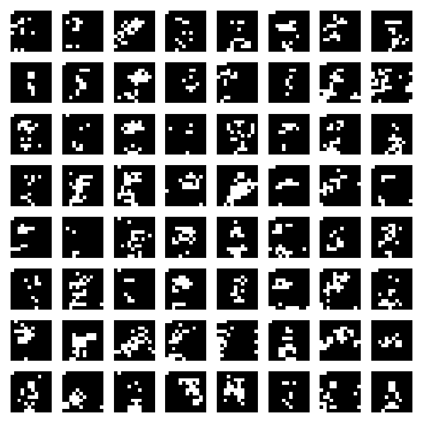
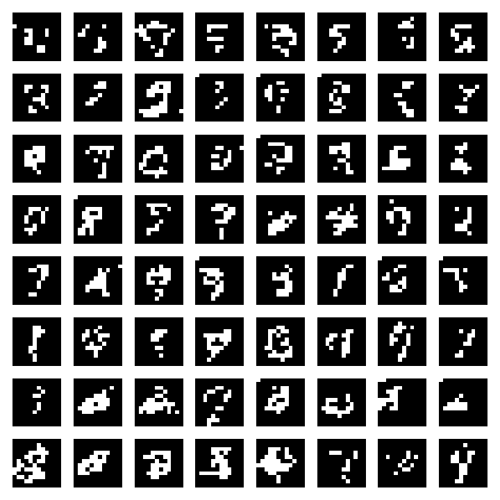
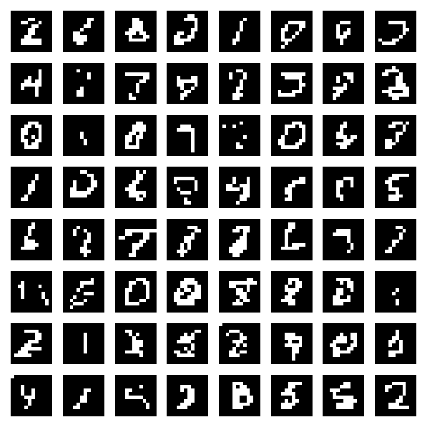
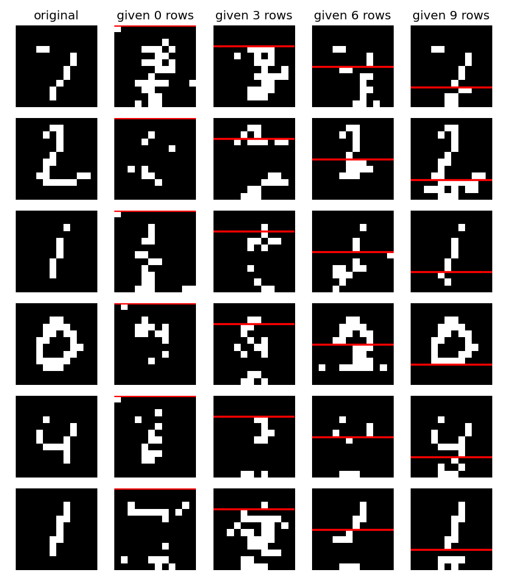
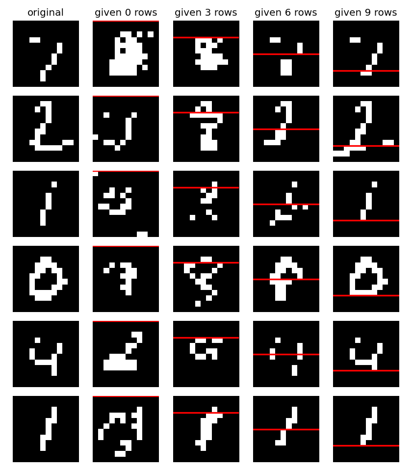
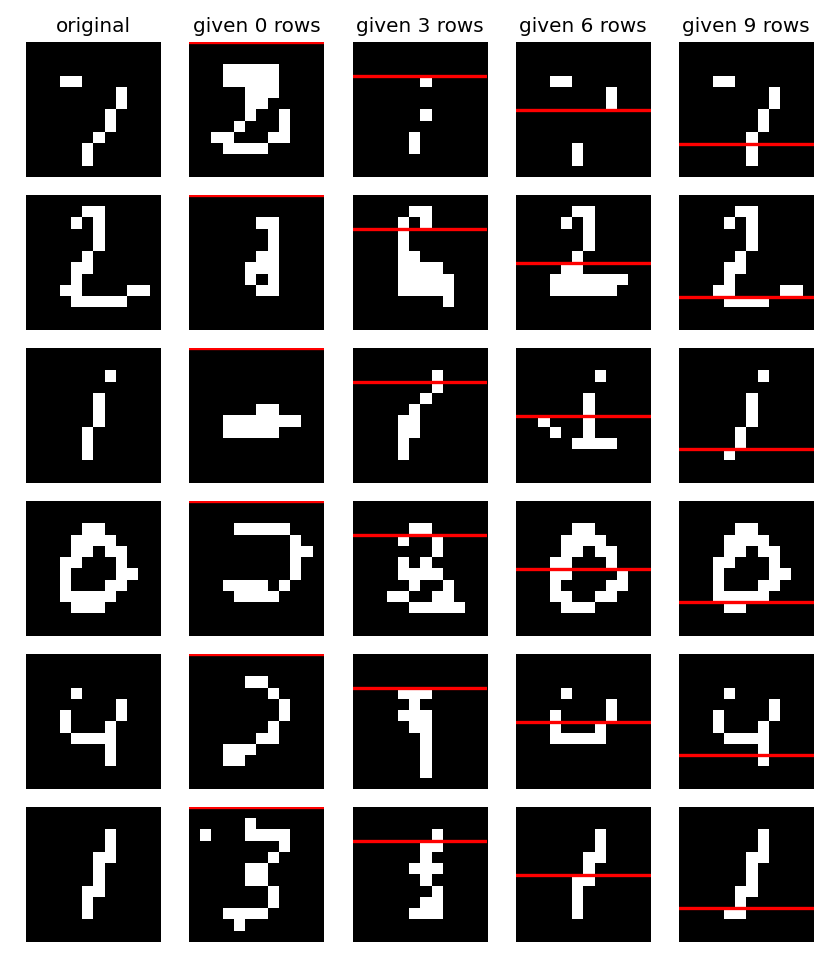

# 02 – Autoregressive image model (LSTM on 12×12 MNIST)

An image is turned into a **sequence of 144 binary pixels** (row by row) and a recurrent network learns to
predict each pixel from all pixels before it. Generating an image means sampling pixel after pixel.

```bash
python train.py              # a few minutes on a GPU; options: --epochs 10 --batch-size 128 --lr 1e-3
```

Output: `outputs/samples.png`, `outputs/completions.png`, `outputs/pixel_lstm.pt`.

## The idea in one formula

The chain rule of probability lets us write the distribution of an image as a product of simple conditionals:

$$p(x) = \prod_{i=1}^{144} p(x_i \mid x_1,\dots,x_{i-1})$$

Every factor is a Bernoulli distribution (pixel is black or white), so the network only has to output **one logit per
position**. Training = maximum likelihood = minimizing the binary cross-entropy summed over all positions.

## Code walkthrough

### Block 1 – Arguments and device

```python
p.add_argument("--epochs", type=int, default=10) ...
device = torch.device("cuda" if torch.cuda.is_available() else "mps" if ... else "cpu")
torch.manual_seed(0)
S = 12
```

Hyperparameters are command-line flags so the same file runs on a laptop and in a SLURM job. The device is picked
automatically (NVIDIA GPU → Apple GPU → CPU). The seed makes runs repeatable (up to GPU non-determinism).
`S` is the image side; the sequence length is `S*S = 144`.

### Block 2 – Data

```python
def load(train):
    x = datasets.MNIST(args.data, train=train, download=True).data.float().div(255).unsqueeze(1)
    x = F.interpolate(x, size=(S, S), mode="bilinear", antialias=True)
    return (x > 0.5).float().flatten(1).to(device)   # [N, 144], values in {0, 1}
```

1. `MNIST(...).data` is the raw `uint8` tensor `[N, 28, 28]`; we scale it to `[0, 1]`.
2. We downscale to 12×12 (with anti-aliasing so thin strokes survive) – a shorter sequence trains much faster.
3. We **binarize** at 0.5. This is what makes a Bernoulli output distribution legitimate: pixels *are* 0 or 1.
4. `flatten(1)` turns each image into a vector of 144 values (row-major: first row, second row, …).

The whole data set is only a few MB, so it lives **on the GPU as one tensor** – no `DataLoader` needed.

### Block 3 – The model

```python
class PixelLSTM(nn.Module):
    def __init__(self, hidden=128):
        self.lstm = nn.LSTM(1, hidden, batch_first=True)
        self.fc = nn.Linear(hidden, 1)
    def forward(self, x, state=None):          # x: [B, T, 1] -> logits [B, T]
        h, state = self.lstm(x, state)
        return self.fc(h).squeeze(-1), state
```

- The LSTM reads **one pixel per time step** (input size 1) and keeps a memory (`hidden=128`) summarizing everything
  seen so far – this memory plays the role of the conditioning set $x_{<i}$.
- `fc` maps the hidden state at step *t* to a single logit: the belief that the **next** pixel is white.
- `forward` also returns and accepts `state`. During training we ignore it; during sampling it lets us feed one pixel
  at a time and continue where we left off.

### Block 4 – Training loop

```python
x = train_x[perm[i:i + args.batch_size]]              # targets: all 144 pixels
inp = F.pad(x[:, :-1], (1, 0)).unsqueeze(-1)          # inputs: shifted right, a 0 stands in for "start"
logits, _ = model(inp)
loss = F.binary_cross_entropy_with_logits(logits, x)
```

The key trick is the **shift by one** (*teacher forcing*):

```
position:   0   1   2   3  ...  143
input:     [0] x0  x1  x2  ...  x142      <- what the model sees at step t
target:     x0  x1  x2  x3 ...  x143      <- what it has to predict at step t
```

At step *t* the network has only seen $x_{<t}$ and has to predict $x_t$, so it can never "peek" at the answer. The leading
`0` is a start symbol that lets the model also predict the very first pixel. Because all steps are processed in
parallel, one forward pass trains all 144 conditionals at once.

`binary_cross_entropy_with_logits` is $-\log p(x_t \mid x_{<t})$ averaged over all positions; the sigmoid is built in,
which is numerically more stable than applying it yourself.

After each epoch we also compute the **test NLL** – the negative log-likelihood of unseen images in nats per image
(sum over the 144 positions). Lower is better. For reference: a model that guesses every pixel with probability ½ has
$144 \cdot \ln 2 \approx 99.8$ nats.

### Block 5 – Sampling

```python
@torch.no_grad()
def generate(n, prefix=None):
    x = torch.zeros(n, S * S)
    inp, state = torch.zeros(n, 1, 1), None
    for i in range(S * S):
        logits, state = model(inp, state)
        pix = torch.bernoulli(torch.sigmoid(logits[:, -1]))
        if prefix is not None and i < prefix.shape[1]:
            pix = prefix[:, i]
        x[:, i] = pix
        inp = pix.view(n, 1, 1)
```

Generation is **sequential** – this is the price of autoregressive models: 144 forward passes for one image.

- Start with the start symbol, ask the model for $p(x_0)$, **draw** a pixel with `torch.bernoulli`, feed it back as the
  next input, and repeat. (Sampling instead of thresholding is essential: it is what makes the images diverse.)
- Because the LSTM `state` carries the history, each step only needs the newest pixel, not the whole prefix again.
- With `prefix` given, the first *k* pixels are **forced** to be the ones of a real image and the model only invents the
  rest – image completion for free, because the model is a conditional distribution at every position.

### Block 6 – Figures

`samples.png` shows 64 unconditional samples. `completions.png` takes six test digits, reveals the first 0, 3, 6 or 9 of
the 12 rows (red line) and lets the model finish the picture.

## Exemplary output

Run on an Apple M-series GPU (`--epochs 10`):

```
epoch 1/10   train loss 0.2423  test NLL 34.37 nats/image
epoch 2/10   train loss 0.2134  test NLL 29.74 nats/image
epoch 3/10   train loss 0.1932  test NLL 27.87 nats/image
epoch 5/10   train loss 0.1723  test NLL 24.81 nats/image
epoch 7/10   train loss 0.1634  test NLL 23.31 nats/image
epoch 10/10  train loss 0.1635  test NLL 22.39 nats/image
```

(`train loss` is the per-pixel loss of the last mini-batch, so it is noisy. Per image it is roughly ×144.)

**Unconditional samples after 1, 3 and 10 epochs**

| 1 epoch | 3 epochs | 10 epochs |
|:--:|:--:|:--:|
|  |  |  |

After one epoch the model has only learned *where* ink tends to be (blobs in the centre, black borders). After three
epochs strokes become connected; after ten, the samples consist of clean, digit-like strokes and a few are clearly
recognizable digits (0, 1, 2, 4), but many are still "almost digits". This is a deliberately tiny model (one LSTM layer
on 12×12 pixels); more epochs, a larger hidden state or more layers improve this.

**Completions after 1, 3 and 10 epochs** (red line = revealed part)

| 1 epoch | 3 epochs | 10 epochs |
|:--:|:--:|:--:|
|  |  |  |

Note how the more rows are given, the more the completion agrees with the original, and how different digits can be
produced when only the top is given (the data is ambiguous – the model samples a plausible continuation, it does not
"recall" the original).

## Things to try

- Increase `S` to 16 or 20: the sequence gets longer, training and sampling slow down, quality improves.
- Replace the `nn.LSTM` by `nn.GRU` or a small Transformer with a causal mask.
- Sample with a temperature: divide the logits by 0.7 or 1.5 before the sigmoid.
- Drop the binarization and use a 256-way softmax per pixel (as in PixelRNN).
