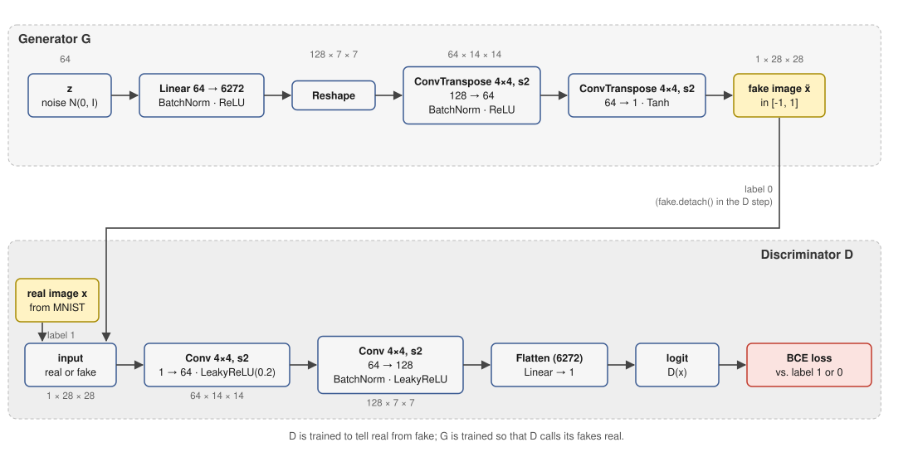
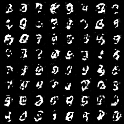
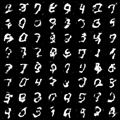
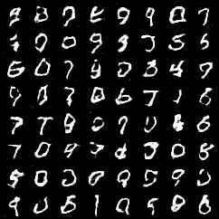
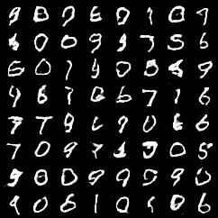
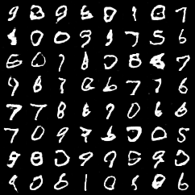
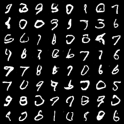
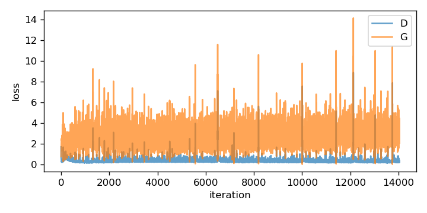

# 03 – Generative Adversarial Network (DCGAN-style) on MNIST

Two networks play a game: the **generator G** turns random noise into images, the **discriminator D** tries to tell
these fakes from real MNIST digits. G never sees a real image – it only learns from the gradient that flows back
through D.

```bash
python train.py              # a few minutes on a GPU; options: --epochs 30 --batch-size 128 --lr 2e-4 --z-dim 64 --sample-every 5
```

Output: `outputs/samples_epoch_*.png` (same 64 noise vectors at every snapshot), `outputs/losses.png`, `outputs/generator.pt`.



## The idea in formulas

D outputs a probability that its input is real, G maps noise $z \sim \mathcal N(0, I)$ to an image. The original
minimax game is

$$\min_G \max_D \; \mathbb E_{x \sim p_\text{data}}[\log D(x)] + \mathbb E_{z}[\log (1 - D(G(z)))]$$

In practice G is trained with the **non-saturating** variant: instead of *minimizing* $\log(1-D(G(z)))$ (which has
vanishing gradients when D wins early) it *maximizes* $\log D(G(z))$. Both steps are then ordinary binary
cross-entropy with a label:

| step | updates | real images get label | fake images get label |
|---|---|---|---|
| D step | D | 1 | 0 |
| G step | G | – | **1** (G wants D to be fooled) |

## Code walkthrough

### Block 1 – Arguments, device, seed

Same pattern as in all examples: hyperparameters as flags, device picked automatically, `torch.manual_seed(0)`.
`--z-dim` is the size of the noise vector; `--sample-every` controls how often a snapshot image is written.
`lr=2e-4` (together with `betas=(0.5, 0.999)` below) is the well-known DCGAN setting.

### Block 2 – Data

```python
data = datasets.MNIST(args.data, train=True, download=True).data
data = (data.float().div(255) * 2 - 1).unsqueeze(1).to(device)   # [60000, 1, 28, 28] in [-1, 1]
```

Pixels are scaled to **[-1, 1]** because the generator ends with `Tanh`, whose output range is exactly (-1, 1) – real and
fake images must live in the same range, otherwise D could simply look at the range. `unsqueeze(1)` adds the channel
axis. The data set is small, so it is kept on the GPU as a single tensor.

### Block 3 – Generator

```python
G = nn.Sequential(
    nn.Linear(args.z_dim, 128 * 7 * 7), nn.BatchNorm1d(128 * 7 * 7), nn.ReLU(),
    nn.Unflatten(1, (128, 7, 7)),
    nn.ConvTranspose2d(128, 64, 4, 2, 1), nn.BatchNorm2d(64), nn.ReLU(),   # 7 -> 14
    nn.ConvTranspose2d(64, 1, 4, 2, 1), nn.Tanh(),                         # 14 -> 28
)
```

G is a decoder: it must create 784 pixels from 64 random numbers.

1. A linear layer expands $z$ to 128·7·7 = 6272 numbers, which `Unflatten` arranges as 128 small 7×7 feature maps.
2. Two **transposed convolutions** (kernel 4, stride 2, padding 1) each **double** the resolution: 7→14→28. Think of
   them as learned upsampling.
3. `BatchNorm` + `ReLU` after hidden layers stabilize training; the last layer uses `Tanh` to produce pixel values in [-1, 1].

### Block 4 – Discriminator

```python
D = nn.Sequential(
    nn.Conv2d(1, 64, 4, 2, 1), nn.LeakyReLU(0.2),                           # 28 -> 14
    nn.Conv2d(64, 128, 4, 2, 1), nn.BatchNorm2d(128), nn.LeakyReLU(0.2),    # 14 -> 7
    nn.Flatten(), nn.Linear(128 * 7 * 7, 1),
)
```

D is an ordinary CNN classifier with strided convolutions instead of pooling. `LeakyReLU` lets a small gradient pass for
negative inputs, which helps G receive gradients. The last layer outputs **one logit** ("how real is this?"), *not* a
probability – the sigmoid is folded into the loss function (`binary_cross_entropy_with_logits`) for numerical stability.

### Block 5 – Optimizers and loss

```python
opt_g = torch.optim.Adam(G.parameters(), lr=args.lr, betas=(0.5, 0.999))
opt_d = torch.optim.Adam(D.parameters(), lr=args.lr, betas=(0.5, 0.999))
bce = F.binary_cross_entropy_with_logits
```

Each network has **its own optimizer** that only knows its own parameters – this is how we make sure the D step does
not change G and vice versa. `beta1 = 0.5` (instead of the default 0.9) reduces momentum, which is known to calm the
oscillations typical for adversarial training.

### Block 6 – Training loop

```python
real = data[perm[i:i + args.batch_size]]
fake = G(torch.randn(len(real), args.z_dim, device=device))
ones, zeros = torch.ones(len(real), 1, ...), torch.zeros(len(real), 1, ...)

# discriminator step: real -> 1, fake -> 0
loss_d = bce(D(real), ones) + bce(D(fake.detach()), zeros)
opt_d.zero_grad(); loss_d.backward(); opt_d.step()

# generator step: make D say "real" for fakes
loss_g = bce(D(fake), ones)
opt_g.zero_grad(); loss_g.backward(); opt_g.step()
```

- One iteration: draw a batch of real images, sample noise, generate a batch of fakes.
- **D step.** Real images should score 1, fakes 0. `fake.detach()` cuts the computation graph at the generator's output:
  gradients of `loss_d` must not flow into G (G is not supposed to learn from *this* loss).
- **G step.** We reuse the *same* fakes but now label them **1**. `loss_g` is small when D believes the fakes are real.
  `loss_g.backward()` sends gradients *through D* into G (D's weights get gradients as well, but we do not step `opt_d`, and
  the next `opt_d.zero_grad()` clears them).
- The two steps alternate every iteration – a 1:1 schedule that is enough for this easy data set.

### Block 7 – Snapshots

```python
fixed_z = torch.randn(64, args.z_dim, device=device)
...
G.eval()
with torch.no_grad():
    save_image(G(fixed_z), out / f"samples_epoch_{epoch:03d}.png", nrow=8, normalize=True, value_range=(-1, 1))
G.train()
```

Using the **same noise vectors** at every snapshot lets you watch *the same 64 samples* improve during training.
`G.eval()` makes BatchNorm use its running statistics instead of batch statistics; `value_range=(-1, 1)` maps Tanh
outputs back to grey values.

### Block 8 – Loss curves

`losses.png` plots both losses per iteration. Unlike in a classifier, **the curves do not tell you how good the images
are** (see below), so always look at samples.

## Exemplary output

```
epoch 1/30   loss D 0.326  loss G 1.924
epoch 5/30   loss D 0.384  loss G 4.795
epoch 10/30  loss D 0.587  loss G 0.771
epoch 15/30  loss D 0.334  loss G 2.211
epoch 20/30  loss D 0.262  loss G 3.274
epoch 25/30  loss D 0.247  loss G 3.807
epoch 30/30  loss D 0.274  loss G 2.549
```

**The same 64 noise vectors during training** (epochs 1, 2, 5, 10, 20, 30):

| epoch 1 | epoch 2 | epoch 5 |
|:--:|:--:|:--:|
|  |  |  |
| **epoch 10** | **epoch 20** | **epoch 30** |
|  |  |  |

GANs learn quickly on MNIST: after one epoch there are already digit-like strokes, but they are ragged and some are
deformed. By epoch 5 most samples are clean, and the later epochs add only modest improvements. Because the noise vectors
are fixed, the same position in the grid always comes from the same noise vector, so you can follow how one sample
changes (or not) from snapshot to snapshot.

**Loss curves**



- D's loss stays mostly below 1 and G's loss fluctuates between about 1 and 5 with occasional spikes – **this is normal**. If
  either network "won" (D loss → 0), training would stall because the other no longer receives useful gradients.
- The curves do not decrease steadily as in supervised learning. They reflect a *game*, not the distance to a fixed target.
  Image quality improves quickly in the first epochs although the loss curves look the same from start to end.

## Things to try

- Train with `--lr 1e-3` or remove `BatchNorm` and watch the training become unstable or collapse.
- Look for **mode collapse**: if all samples look like the same digit, G has found one output that fools D.
- Make G *conditional*: concatenate a one-hot class label to $z$ and to D's input (cGAN).
- Interpolate between two noise vectors $z_1, z_2$ and decode the path.
