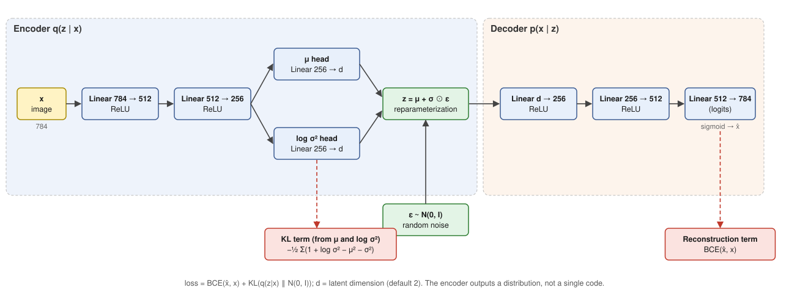
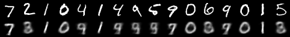
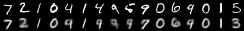
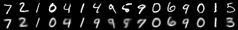
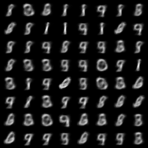
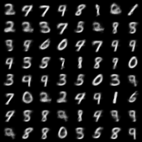
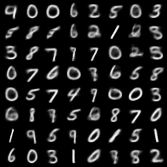
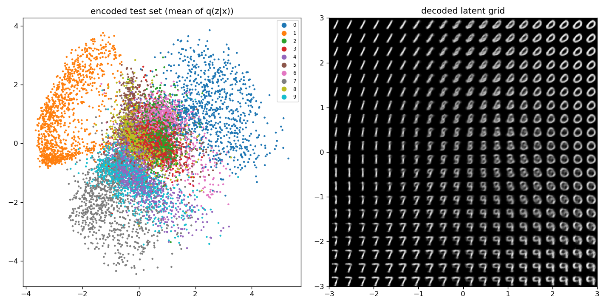
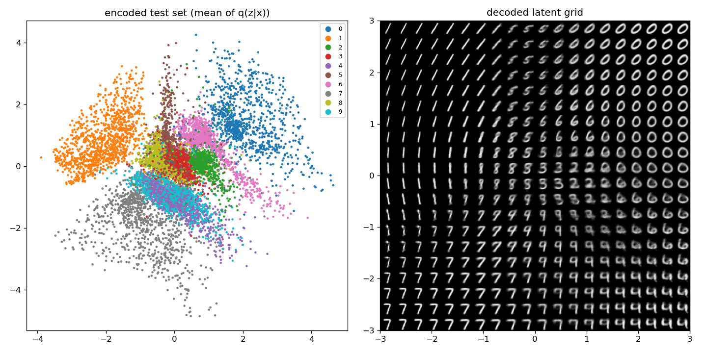
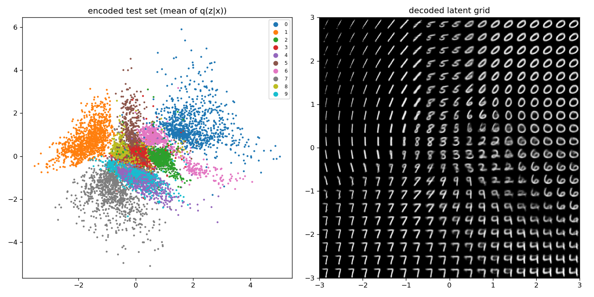

# 04 – Variational Autoencoder (VAE) on MNIST

An autoencoder squeezes an image into a small code and reconstructs it. A **variational** autoencoder additionally forces
the codes to follow a simple known distribution, $\mathcal N(0, I)$. Then we can **generate** new images: draw a random code from
that distribution and decode it.

```bash
python train.py                     # options: --epochs 20 --batch-size 128 --lr 1e-3 --latent-dim 2
python train.py --latent-dim 16     # better samples, but no 2-D latent plot
```

Output: `outputs/reconstructions.png`, `outputs/samples.png`, `outputs/latent_space.png` (only for `--latent-dim 2`), `outputs/vae.pt`.



## The idea in formulas

The encoder does not output a code but a **distribution** $q(z\mid x) = \mathcal N(\mu(x), \operatorname{diag}\sigma^2(x))$; the decoder defines
$p(x\mid z)$. Training maximizes the evidence lower bound (ELBO), i.e. we **minimize**

$$\mathcal L = \underbrace{-\mathbb E_{z\sim q(z\mid x)}\big[\log p(x\mid z)\big]}_{\text{reconstruction}} \;+\; \underbrace{\mathrm{KL}\big(q(z\mid x)\,\|\,\mathcal N(0,I)\big)}_{\text{regularizer}}$$

- **Reconstruction:** the decoded image must look like the input. With pixels in [0, 1] we treat each pixel as a Bernoulli
  variable, which gives the binary cross-entropy.
- **KL term:** keeps every encoded distribution close to the prior, so that the latent space is "filled" and a random $z$ decodes to
  something meaningful. For Gaussians it has the closed form $-\tfrac12\sum_j (1 + \log\sigma_j^2 - \mu_j^2 - \sigma_j^2)$.

The two terms pull against each other: the reconstruction wants distinct, precise codes; the KL term wants all codes to
look the same (the prior).

## Code walkthrough

### Block 1 – Arguments, device, seed

As in every example. `--latent-dim` is the size of $z$; the default of 2 makes the latent space directly plottable.

### Block 2 – Data

```python
def load(train):
    ds = datasets.MNIST(args.data, train=train, download=True)
    return ds.data.float().div(255).flatten(1).to(device), ds.targets
```

Images are scaled to [0, 1] (needed for the Bernoulli/BCE likelihood) and **flattened to vectors of 784** – the VAE here is a
plain MLP. The labels are only used to colour the latent-space plot; **training never sees them**.

### Block 3 – The model

```python
class VAE(nn.Module):
    def __init__(self, zdim):
        self.enc = nn.Sequential(nn.Linear(784, 512), nn.ReLU(), nn.Linear(512, 256), nn.ReLU())
        self.mu, self.logvar = nn.Linear(256, zdim), nn.Linear(256, zdim)
        self.dec = nn.Sequential(nn.Linear(zdim, 256), nn.ReLU(), nn.Linear(256, 512), nn.ReLU(), nn.Linear(512, 784))

    def forward(self, x):
        h = self.enc(x)
        mu, logvar = self.mu(h), self.logvar(h)
        z = mu + torch.randn_like(mu) * torch.exp(0.5 * logvar)   # reparameterization trick
        return self.dec(z), mu, logvar
```

- **Encoder** (`enc`): two layers compress 784 → 256 features. Two separate linear **heads** turn them into the mean $\mu$ and
  the log-variance $\log\sigma^2$ of the Gaussian. Predicting the *log*-variance means the network may output any real
  number while $\sigma^2 = e^{\text{logvar}}$ is always positive.
- **Reparameterization trick.** We need a random sample $z\sim\mathcal N(\mu,\sigma^2)$, but back-propagation cannot go through a
  random draw. Writing $z = \mu + \sigma\odot\varepsilon$ with $\varepsilon\sim\mathcal N(0,I)$ moves all randomness into $\varepsilon$, which needs no
  gradient; $\mu$ and $\sigma$ stay differentiable. `exp(0.5 * logvar)` is $\sigma$.
- **Decoder** (`dec`): the mirror image, from $z$ back to 784 values. It outputs **logits**; the sigmoid is applied only for
  display (and is folded into the loss during training).

### Block 4 – Loss

```python
def loss_fn(logits, x, mu, logvar):
    rec = F.binary_cross_entropy_with_logits(logits, x, reduction="sum")
    kl = -0.5 * torch.sum(1 + logvar - mu**2 - logvar.exp())
    return (rec + kl) / len(x), rec / len(x), kl / len(x)
```

`reduction="sum"` adds the BCE over all pixels *and* all images, so reconstruction and KL are on the same scale
(both are sums over dimensions). Dividing by the batch size gives the loss **per image in nats**. A common mistake is to
use the *mean* BCE (÷784) next to a *summed* KL: the KL term then dominates and the model ignores the input
(*posterior collapse*).

### Block 5 – Training loop

```python
logits, mu, logvar = model(x)
loss, rec, kl = loss_fn(logits, x, mu, logvar)
opt.zero_grad(); loss.backward(); opt.step()
```

Ordinary mini-batch training with Adam. The log prints the total loss and its two parts – watch how much each contributes.

### Block 6 – Evaluation and figures

```python
mu = model.mu(model.enc(x))
recon = torch.sigmoid(model.dec(mu))                  # reconstructions
z = torch.randn(64, args.latent_dim, device=device)   # generation
samples = torch.sigmoid(model.dec(z))
```

- **Reconstructions** use $\mu$ directly (no noise) – the best guess of the encoder. Top row: test images, bottom row: output.
- **Generation:** this is the whole point. Draw $z$ from the *prior* $\mathcal N(0,I)$ and send it through the decoder. The encoder is not needed.
- **Latent space plot** (`--latent-dim 2` only). Left: the 2-D mean $\mu$ of every test image, coloured by digit class. Right:
  a regular 20×20 grid of $z$ values in $[-3,3]^2$, decoded. The grid shows what the decoder "does" in each part of the latent space.

## Exemplary output

```
epoch 1/20   loss 160.24  (rec 155.35 + KL 4.89)
epoch 2/20   loss 157.33  (rec 151.57 + KL 5.77)
epoch 5/20   loss 149.08  (rec 143.10 + KL 5.98)
epoch 10/20  loss 149.15  (rec 142.81 + KL 6.34)
epoch 15/20  loss 144.45  (rec 137.64 + KL 6.80)
epoch 20/20  loss 136.83  (rec 130.00 + KL 6.83)
```

(All values: nats per image, last mini-batch of the epoch, hence the jitter.) The reconstruction term decreases steadily;
the KL term slowly *grows* from 4.9 to 6.8 – the encoder learns to use the latent space more, and pays a little more for it.

**Reconstructions** (top: test image, bottom: reconstruction) after 1, 5 and 20 epochs:

| epoch | reconstructions |
|:--:|:--:|
| 1 |  |
| 5 |  |
| 20 |  |

Reconstructions are **blurry** – typical for a VAE with a pixel-wise likelihood – and with only 2 latent dimensions some
digits are confused (e.g. 4 and 9 look alike in latent space, a few other digits are replaced by a similar one).

**Samples from the prior** ($z\sim\mathcal N(0,I)$) after 1, 5 and 20 epochs:

| 1 epoch | 5 epochs | 20 epochs |
|:--:|:--:|:--:|
|  |  |  |

**The 2-D latent space** (left: encoded test set, right: decoded grid) after 1, 5 and 20 epochs:





Already after one epoch the classes are arranged in distinct regions (1 on the left, 0 on the upper right, 7 on the bottom left),
**although no label was ever used**. The decoded grid shows smooth transitions between digits, e.g. from 7 over 9 to 4.
With more epochs the regions become sharper; the clouds stay centred near the origin because of the KL term.
Classes that look similar (4/9, 3/5/8) overlap – 2 dimensions are simply not enough to separate all digits. With
`--latent-dim 16` the samples are clearly better, but there is no longer a 2-D picture to look at.

## Things to try

- Compare `--latent-dim 2, 8, 16, 32` and look at samples and the KL value in the log.
- Multiply the KL term by β (β-VAE): β > 1 gives smoother, more disentangled but blurrier results, β → 0 turns the model into a plain autoencoder (and sampling from the prior fails).
- Interpolate between the codes of two test images and decode the path.
- Replace the MLP by a convolutional encoder/decoder.
