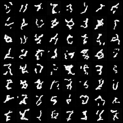
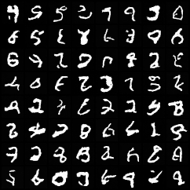
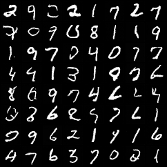
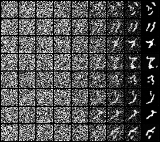
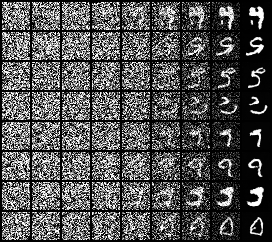
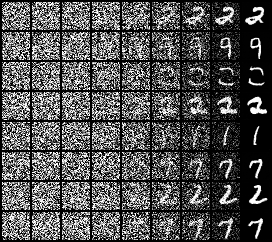

# 05 – Denoising Diffusion Probabilistic Model (DDPM) on MNIST

A diffusion model learns to **remove noise**. Training images are destroyed step by step by adding Gaussian noise
(*forward process*, no learning involved); a neural network is trained to undo a single noise step. Generation starts from
pure noise and applies the network many times (*reverse process*) until an image emerges.

```bash
python train.py              # options: --epochs 20 --batch-size 128 --lr 5e-4 --timesteps 1000
```

Output: `outputs/forward_process.png`, `outputs/samples.png`, `outputs/reverse_process.png`, `outputs/ddpm_unet.pt`.
This is the slowest example (training *and* 1000 sampling steps) – on a laptop GPU an epoch takes about two minutes, on an HPC3 GPU share much less.

## The idea in formulas

**Forward process.** With a noise schedule $\beta_1,\dots,\beta_T$ (small numbers), each step is
$x_t = \sqrt{1-\beta_t}\,x_{t-1} + \sqrt{\beta_t}\,\varepsilon$. Define $\alpha_t = 1-\beta_t$ and $\bar\alpha_t = \prod_{s\le t}\alpha_s$. Because sums of Gaussians are Gaussian, we can jump **directly** to any step:

$$x_t = \sqrt{\bar\alpha_t}\,x_0 + \sqrt{1-\bar\alpha_t}\,\varepsilon,\qquad \varepsilon\sim\mathcal N(0,I)$$

For large $t$, $\bar\alpha_t\to 0$ and $x_t$ is pure noise.

**Training.** A network $\varepsilon_\theta(x_t, t)$ predicts the noise that was added. The loss is simply

$$\mathcal L = \mathbb E_{x_0,\,t,\,\varepsilon}\big\|\varepsilon - \varepsilon_\theta(x_t, t)\big\|^2$$

**Sampling.** Start with $x_T\sim\mathcal N(0,I)$ and for $t = T,\dots,1$:

$$x_{t-1} = \frac{1}{\sqrt{\alpha_t}}\Big(x_t - \frac{\beta_t}{\sqrt{1-\bar\alpha_t}}\,\varepsilon_\theta(x_t,t)\Big) + \sqrt{\beta_t}\,z,\qquad z\sim\mathcal N(0,I)\ (z=0 \text{ in the last step})$$

## Code walkthrough

### Block 1 – Arguments, device, data

As in the GAN example: images are scaled to **[-1, 1]** (so that they are symmetric around 0 like the noise) and kept on the GPU as one tensor.
`--timesteps` is $T$, the length of the diffusion chain.

### Block 2 – Noise schedule

```python
T = args.timesteps
betas = torch.linspace(1e-4, 0.02, T, device=device)
alphas = 1 - betas
abar = torch.cumprod(alphas, 0)          # abar_t = prod_{s<=t} alpha_s

def q_sample(x0, t, eps):
    a = abar[t].view(-1, 1, 1, 1)
    return a.sqrt() * x0 + (1 - a).sqrt() * eps
```

- `betas` is the (linear) schedule from the original paper: the noise added per step grows from 0.0001 to 0.02.
- `torch.cumprod` computes $\bar\alpha_t$ for all $t$ at once. All of these are tiny tensors of length $T$ that live on the GPU and are indexed by `t`.
- `q_sample` is the closed-form forward process: **one line takes a clean image to any noise level**. This is what makes training
  cheap – we never have to simulate the chain. `abar[t]` picks one value per image in the batch, `.view(-1, 1, 1, 1)` lets it broadcast over C×H×W.

### Block 3 – Time embedding

```python
def time_embedding(t, dim):
    freqs = torch.exp(-math.log(10000) * torch.arange(dim // 2, device=t.device) / (dim // 2))
    a = t[:, None].float() * freqs[None]
    return torch.cat([a.sin(), a.cos()], dim=1)
```

The network must know **how noisy** its input is: removing a little noise and removing a lot of noise are different tasks.
The integer $t$ is turned into a vector of sines and cosines of different frequencies (the same positional encoding as in a
Transformer). Nearby $t$ get similar vectors, and a small MLP (`self.temb`) can turn them into something useful.

### Block 4 – The U-Net

```python
class ResBlock(nn.Module):
    def forward(self, x, temb):
        h = self.c1(F.silu(self.n1(x)))
        h = h + self.t(temb)[:, :, None, None]       # inject the timestep
        h = self.c2(F.silu(self.n2(h)))
        return h + self.skip(x)
```

A **residual block**: GroupNorm → SiLU → 3×3 convolution, twice, plus a shortcut `h + skip(x)`. The time embedding is projected to
one number per channel and **added** to the feature maps in the middle, so every block knows the noise level.
(`skip` is a 1×1 convolution when the number of channels changes.)

```python
class UNet(nn.Module):
    def forward(self, x, t):
        temb = self.temb(time_embedding(t, self.tdim))
        h1 = self.down1(self.inp(x), temb)                                            # 28x28
        h2 = self.down2(self.pool(h1), temb)                                          # 14x14
        h = self.mid(self.pool(h2), temb)                                             # 7x7
        h = self.up2(torch.cat([F.interpolate(h, scale_factor=2), h2], 1), temb)      # 14x14
        h = self.up1(torch.cat([F.interpolate(h, scale_factor=2), h1], 1), temb)      # 28x28
        return self.out(h)
```

The **U-Net** is the standard architecture for image-to-image tasks, because the output (predicted noise) has the same shape as the input:

- **Down path:** resolution 28 → 14 → 7, more channels (64 → 128). Deep layers see a large part of the image.
- **Up path:** resolution back to 28 by nearest-neighbour upsampling (`F.interpolate`).
- **Skip connections** (`torch.cat([..., h2], 1)`): the high-resolution features from the down path are concatenated to the up path.
  Without them, fine detail (where exactly is the noise?) would be lost in the bottleneck.
- The last block maps back to **1 channel**: the predicted noise $\varepsilon_\theta$.

This tiny U-Net has 1.3 M parameters and **no attention layers** – enough for MNIST; larger images need more resolution levels and attention.

### Block 5 – Training loop

```python
x0 = data[perm[i:i + args.batch_size]]
t = torch.randint(0, T, (len(x0),), device=device)    # a random timestep per image
eps = torch.randn_like(x0)
loss = F.mse_loss(model(q_sample(x0, t, eps), t), eps)
```

Each iteration: (1) take clean images, (2) pick a **random noise level** for every image, (3) draw the noise, (4) create the noisy image in closed
form, (5) ask the network for the noise and compare with the truth via MSE. Randomizing $t$ means one network learns **all** noise levels at the same time.
Training is a plain regression – much more stable than a GAN, there is no adversary.

### Block 6 – Sampling

```python
@torch.no_grad()
def sample(n, snapshots=()):
    x = torch.randn(n, 1, 28, 28, device=device)
    for t in reversed(range(T)):
        eps = model(x, torch.full((n,), t, device=device))
        mean = (x - betas[t] / (1 - abar[t]).sqrt() * eps) / alphas[t].sqrt()
        x = mean + betas[t].sqrt() * torch.randn_like(x) if t > 0 else mean
```

Start from pure noise and walk the chain **backwards**, T = 1000 network evaluations per image (the price of diffusion: slow sampling).
In each step the network predicts the noise in $x_t$, we subtract the corresponding part to obtain the mean of $x_{t-1}$ and add a little fresh
noise – that fresh noise is what keeps the samples diverse. At the very last step (`t == 0`) no noise is added. Compare this line with the
sampling formula above – it is a literal translation.

### Block 7 – Figures

- `forward_process.png`: one test image at $t = 0, 100, 200, 300, 400, 500, 700, 999$ – *what the network is trained to undo*.
- `samples.png`: 64 generated digits.
- `reverse_process.png`: the first 8 samples while being denoised – nine columns, from $t = 999$ (noise) via $t = 875, 750, \dots, 125$ to $t = 0$ (image).

## Exemplary output

Run on an Apple M-series GPU (`--epochs 15`; one epoch ≈ 2 minutes there, plus the 1000-step sampling at the end):

```
U-Net with 1.34 M parameters
epoch 1/15   loss 0.0320
epoch 2/15   loss 0.0344
epoch 5/15   loss 0.0245
epoch 10/15  loss 0.0280
epoch 13/15  loss 0.0208
epoch 15/15  loss 0.0263
```

The loss is the mean squared error of the **noise prediction** (last mini-batch). It drops quickly during the first epoch and then
only creeps down and jitters, because each batch contains random noise levels $t$ – some much harder than others – and a floor
remains (at high noise the exact noise cannot be predicted from the input). **The loss value says little about the sample quality**:
look at the generated images.

**The forward process** (the fixed, non-learned part): one training image at $t = 0, 100, 200, 300, 400, 500, 700, 999$.


The digit is still recognizable for $t\lesssim 200$ and has vanished in noise at $t=999$.

**Samples** (64 images from pure noise, 1000 reverse steps) after 1, 5 and 15 epochs:

| 1 epoch | 5 epochs | 15 epochs |
|:--:|:--:|:--:|
|  |  |  |

After one epoch the network already produces stroke-like structures, but they are rough and disconnected. After 5 epochs many samples look like
(slightly distorted) digits. After 15 epochs most are clean, sharp and varied digits. Compared with the VAE, the samples are **sharp**, not
blurry; compared with the GAN, training was a plain regression and no instability had to be managed – the price is the 1000-step sampling.

**The reverse process** for the first 8 samples (columns: $t = 999, 875, 750, 625, 500, 375, 250, 125, 0$), after 1, 5 and 15 epochs:

| 1 epoch | 5 epochs | 15 epochs |
|:--:|:--:|:--:|
|  |  |  |

The first half of the chain looks like pure noise. The coarse shape of the digit appears around $t\approx 375$–$250$ (large-scale structure is
decided *first*), and the remaining steps sharpen strokes and remove the residual noise. Different noise at the start leads to different digits –
the randomness of the final image is decided in the early, noisy steps (and by the fresh noise added in each step).

## Things to try

- Train longer (`--epochs 50`) and compare. Add an exponential moving average (EMA) of the weights for better samples – the standard trick.
- Use fewer steps (`--timesteps 200`) – training still works, sampling gets 5× faster, but the schedule has to be adapted (e.g. larger $\beta_T$).
- Replace the sampler by **DDIM** (deterministic, 50 steps instead of 1000).
- Make it **conditional**: feed the digit class into the time embedding and train with the class label.
